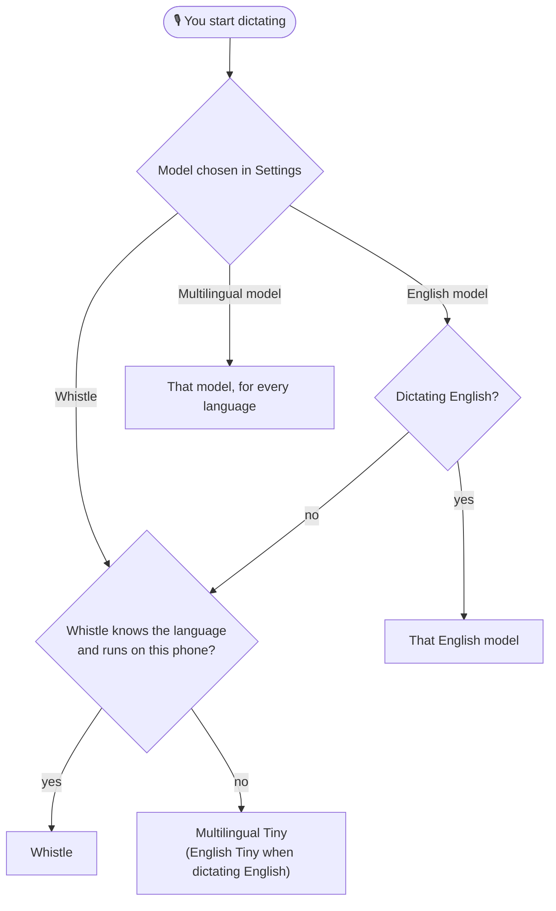
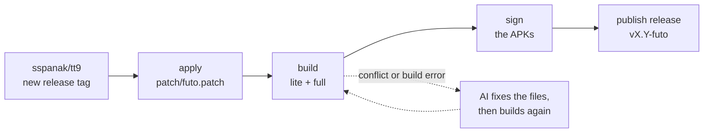

<div align="center">

# 📟 tt9 + FUTO

**Nokia-style T9 for Android, with private, fully offline voice typing.**

[](https://github.com/JMTDI/tt9/actions/workflows/build.yml)
[](https://github.com/JMTDI/tt9/releases/latest)
[](https://github.com/JMTDI/tt9/releases)


[](https://github.com/sspanak/tt9)

[Install](#-install) · [Voice models](#-voice-models) · [Privacy](#-privacy) · [How it works](#-how-it-works) · [FAQ](#-faq) · [Maintainers](#-for-maintainers)

</div>

---

This repo takes every release of [sspanak/tt9](https://github.com/sspanak/tt9), the modern Nokia-style T9 keyboard, and adds
**offline speech-to-text** to it: a built-in **Whistle** model plus six downloadable **FUTO Whisper** models. A GitHub Action
does the rest on its own: it notices a new upstream release, applies [`patch/futo.patch`](patch/futo.patch), builds, signs and
publishes the APKs. There is no fork to keep in sync; the whole difference from upstream is that one patch.

## ✨ Highlights

| | |
| --- | --- |
| 🎙️ **Offline dictation** | Speech is turned into text on the phone. No cloud, no account. |
| 🧠 **Seven voice models** | Whistle is built in. Six FUTO Whisper models (3 English, 3 multilingual) are a tap away in Settings. |
| ⬇️ **Downloads only on demand** | A Whisper model is fetched when you choose it and is rejected unless its SHA-256 matches. Whistle never downloads anything. |
| 🔁 **Always current** | A new upstream release gets a new signed build, usually within a day. |
| 🆔 **Its own app ID** | `com.jmtditech.tt9`, so it installs next to the original app instead of replacing it. |

## 📲 Install

1. Download an APK from the [latest release](https://github.com/JMTDI/tt9/releases/latest):

   | APK | What it is |
   | --- | --- |
   | `tt9-futo-<version>-full.apk` | Everything built in, dictionaries included. Works with no Internet. Android 7.0+. |
   | `tt9-futo-<version>-lite.apk` | Much smaller. Dictionaries are downloaded from GitHub when you add a language. Android 8.0+. |

2. Open it and install. Android may first ask you to allow installs from your browser or file manager.
3. Turn the keyboard on: **Settings → System → Languages & input → On-screen keyboard → Manage keyboards**, switch on
   **Traditional T9**, then pick it as your keyboard. The wording differs a little between phones.
4. Open the T9 settings and look at **Voice input model**. Whistle is already selected, so voice input works right away.

> [!IMPORTANT]
> **Coming from an earlier tt9-futo build?** The app ID changed from `io.github.sspanak.tt9` to `com.jmtditech.tt9`, so this is a
> *new app*, not an update. It installs beside the old one (both are called "Traditional T9"), starts with fresh settings and
> does not touch the old one. Switch your keyboard to the new app, then uninstall the old one.

Every release also has a `SHA256SUMS` file and the exact `futo-<version>.patch` it was built from. APKs are signed with the
maintainer's key, so an update only installs over a build signed with that same key.

## 🎤 Voice models

Open **Settings → Voice input model** (right below *Keypad*). Whistle comes first, then the English models, then the multilingual ones:

```text
Voice input model
 ● Whistle · built in
 ○ English Tiny · 44 MB download
 ○ English Base · 82 MB download
 ○ English Small · 264 MB download
 ○ Multilingual Tiny · 44 MB download
 ○ Multilingual Base · 82 MB download
 ○ Multilingual Small · 264 MB download
```

| Model | Understands | Size | Download? |
| --- | --- | --- | --- |
| ⭐ **Whistle** (default) | English, German, French, Spanish, Italian, Dutch, Polish | built into the APK | **No**, the only one that needs none |
| **English** Tiny · Base · Small | English only | ≈ 44 · 82 · 264 MB | Yes, once |
| **Multilingual** Tiny · Base · Small | 70+ languages | ≈ 44 · 82 · 264 MB | Yes, once |

The Whisper models are FUTO's [ACFT](https://github.com/futo-org/whisper-acft) builds, tuned for short dictation. As with any
Whisper model, a bigger one is more accurate but slower and needs more memory. Sizes are approximate.

### What gets used when you dictate



- **Model not downloaded yet?** The download starts in the background. Whistle covers for it where it can; otherwise a message asks
  you to try again when it has finished.
- **Whistle can't run on your phone?** The app says why and uses a Whisper model instead, as in the chart.
- **Progress and retries:** the *Model status* row under the dropdown shows where the chosen model stands. Tap it to retry a failed download.
- **Where the files come from:** FUTO's servers (`voiceinput.futo.org`, with `dl.voiceinput.futo.org` as a fallback). A file is
  written to a temporary name and kept only if its SHA-256 is the one built into the app, so a broken or swapped download never replaces a good model.

## 🔒 Privacy

- **Your voice stays on the phone.** Whistle and Whisper both run locally.
- **The network is used for model downloads** (when you pick a Whisper model) and, in the *lite* app, for dictionaries from GitHub,
  as upstream does. The *full* app needs the network only for a Whisper model you choose.
- **Permissions added on top of upstream:** `INTERNET` (the downloads), plus `BLUETOOTH` (Android 11 and older) and
  `BLUETOOTH_CONNECT` (Android 12+) for dictating through a Bluetooth headset. Microphone access is upstream's `RECORD_AUDIO`.
- Whistle is a closed-source library whose documentation mentions anonymous usage counts. The app switches them off, but that has
  not been verified in the binary. See [Engine internals](#engine-internals).

## 🔄 How it works



`.github/workflows/build.yml` runs every day at 03:17 UTC (and on demand):

1. Finds the latest upstream `vN.N` tag. If release `<tag>-futo` exists, it stops.
2. Clones upstream at that tag (full history, because upstream derives its version from git).
3. Applies `patch/futo.patch` with a 3-way merge, copies `patch/binaries/cert.der` into place, downloads the
   Whistle speech model (SHA-256 verified; the build stops if it does not match), adds the three manifest permissions and
   points any settings link that still names the old package at `com.jmtditech.tt9`. Upstream's `versionCode`/`versionName` logic is untouched.
4. Builds `assembleLiteRelease assembleFullRelease`. If the patch had conflicts, or the build fails,
   Puter AI edits the affected files and it builds again, up to `max_attempts` (default 5).
5. Signs the APKs with your keystore and creates release `<tag>-futo` with the APKs, SHA-256 sums,
   auto-generated notes (including which files the AI edited) and the exact patch used.
6. Saves the final, possibly AI-resolved, patch back to `patch/futo.patch`, so the next upstream
   release starts from it and usually applies cleanly.

If it never builds: logs are uploaded as an artifact and an issue is opened. Nothing is released.

## ❓ FAQ

<details>
<summary><b>Will it update my old tt9-futo?</b></summary>

No. The app ID is different, so Android treats it as a separate app. Install it, switch your keyboard to it, then uninstall the old one.

</details>

<details>
<summary><b>Which voice model should I pick?</b></summary>

Start with Whistle. It is built in, works right away and covers English, German, French, Spanish, Italian, Dutch and Polish. To try
something else, English Tiny or Base are small and quick for English, and Small is the most accurate and the slowest. For other
languages choose a Multilingual model, and begin with Tiny on an older phone.

</details>

<details>
<summary><b>A model says "Not downloaded yet", or its download failed</b></summary>

Check that you are online, then tap the *Model status* row in Settings to try again. An interrupted or failed download leaves
nothing behind, and a file is only used once its checksum is right.

</details>

<details>
<summary><b>Does dictation work without Internet?</b></summary>

Yes. Whistle needs no network at all, and a Whisper model needs it only for its one-time download.

</details>

<details>
<summary><b>How do I remove a downloaded model?</b></summary>

Models live in the app's private storage. Android's *App info → Storage → Clear storage* removes them, and resets the app's settings too.

</details>

<details>
<summary><b>The release notes say an AI edited some files. Should I worry?</b></summary>

When upstream changes something the patch touches, an AI model resolves the conflict or fixes the build, and the release notes list
every file it edited. Nobody reviews those edits, and a passing build does not prove that no upstream change was dropped, so the
exact patch used is attached to the release for you to read.

</details>

## 🔧 For maintainers

### Setup

1. Push this repo's contents to `JMTDI/tt9` **with git**. Whistle is downloaded during the build, so the repo stays small.
2. Add these Actions secrets: `AI_API_KEY` (the older name `PUTER_AUTH_TOKEN` still works), `KEYSTORE_BASE64` (`base64 -w0 release.jks`),
   `KEYSTORE_PASSWORD`, `KEY_ALIAS`, `KEY_PASSWORD`.
3. Settings > Actions > General > Workflow permissions: **Read and write**.
4. Run the workflow manually once (Actions > Build tt9 + FUTO > Run workflow).

### Rebuilding after you change the patch

Run the workflow with **force** ticked. It rebuilds the newest upstream tag and replaces the existing `<tag>-futo` release, but only
after the build has succeeded, so a failed build leaves the current release alone.

### Notes

- Use a separate Puter account for the token: it grants access to the whole account.
- `PUTER_MODEL` (default `claude-sonnet-4-5`), `PUTER_MAX_TOKENS` and `PUTER_BASE_URL` can be set as
  env vars in the workflow's build step.
- AI edits are only allowed in `app/` and the root Gradle files, never in `.github/`.
- GitHub pauses scheduled workflows after 60 days without commits; the workflow makes an empty
  commit when the repo has been quiet for 45 days.

### AI settings (all optional, repo variables or secrets)

`AI_API_KEY` (secret) is the API key for any OpenAI-compatible endpoint. Variables: `PUTER_BASE_URL`,
`PUTER_MODEL`, `PUTER_FALLBACK_MODELS`, `PUTER_MAX_TOKENS`, and `PUTER_EXTRA_BODY` (a JSON object merged into every
request, e.g. `{"chat_template_kwargs":{"enable_thinking":false}}` for models that can switch reasoning off).

### Patch baseline

`patch/futo.patch` was ported by hand onto upstream v64.0 (upstream removed `ConsumerCompat`, added
`forceAlternativeInput`, and reworked voice input after the fork's v59 base). It also carries the fork's later fixes (model packaged as an asset so the mic button appears, record-until-stopped,
static JNI natives), and then the app ID and the voice-model chooser described below. After each successful build the workflow stores the patch it actually used.

### What the patch changes

| Area | What it does |
| --- | --- |
| App ID | Sets `applicationId` to `com.jmtditech.tt9`. The Java package and `namespace` stay `io.github.sspanak.tt9`, so upstream's code still merges cleanly. The settings links that name the app's own package are repointed, and `apply_patch.sh` repoints any new ones upstream adds. |
| Voice engine | whisper.cpp/ggml with its JNI bridge, the Whistle bridge, and an offline `VoiceInputOps` in place of Android's `SpeechRecognizer`. |
| Model catalog | `ml/WhisperModels` lists the seven models with their file names, SHA-256 and sizes. `ml/VoiceModelChooser` decides which one handles a language. |
| Downloads | `ml/ModelDownloader`, `ModelDownloads` and `ModelFetcher` download one model at a time, verify its SHA-256 and report progress. Everything is plain Java except `ModelDownloader`, which adds Android's storage, certificate and toasts. |
| Settings | `DropDownVoiceModel` ("Voice input model") and `PreferenceVoiceModelStatus` ("Model status"), added to `prefs.xml`. |

To replace a Whisper model, edit its entry in `WhisperModels`: file name, SHA-256 and size. A new one also goes into `ALL`, and the
`id` of an existing model must never change, because it is what the setting stores.

### Engine internals

- **Whistle** ([Cactus Compute](https://cactuscompute.com/blog/whistle), Apache-2.0, 16.9 MB) is bundled in the APK and used
  for English, German, French, Spanish, Italian, Dutch and Polish. It replaced the old English-only Whisper model.
  Recordings longer than 30 seconds are split at pauses and transcribed piece by piece.
- **FUTO Whisper models** (Tiny, Base and Small, English and multilingual) are downloaded on demand. Multilingual Tiny handles
  the languages Whistle lacks, and everything when Whistle cannot run, unless you picked another model.
- The engine is wired up for **arm64-v8a** and **armeabi-v7a** (32-bit ARM, common on keypad phones). On x86/x86_64 the
  bridge builds as a stub, and every language uses a downloaded Whisper model instead: English Tiny for English and
  Multilingual Tiny for the rest, or the model you chose.
- If Whistle cannot be used for one of its seven languages, the app now says why in a toast (CPU not supported, library
  failed to load, or model missing) instead of silently switching to the slower model.
- Each engine is pinned in `app/src/main/cpp/whistle.cmake` to an immutable Hugging Face commit **and** a SHA-256, checked
  by hand after download. A checksum mismatch always stops the build. arm64 must download; the 32-bit engine is
  forgiving: if it cannot be fetched or will not link, the build still succeeds with the stub for that CPU, and the stub
  records why, so the toast on the phone names the cause (it lists the first missing symbols if the link fails).
- Cactus built the 32-bit archive with a newer libc++ than this app's NDK (28.2), so it needs one function the older
  libc++ lacks, `std::__ndk1::__hash_memory`. `whistle_compat.cpp` supplies it (the same MurmurHash2 libc++ uses, weak
  and hidden, so a newer NDK's own copy wins). It is only compiled for 32-bit ARM. The older-Android `stderr` problem
  does not apply, because this app's minimum is Android 7 (API 24).
- The Whistle engine is a prebuilt, closed-source static library (`libneedle.a`), downloaded at build time (pins above). Its published docs say
  it sends anonymous usage counts unless `NEEDLE_TELEMETRY=0` / `DO_NOT_TRACK=1` is set; the bridge sets both before
  loading, but that behaviour comes from the vendor's documentation and has not been verified in the binary. To check,
  watch the app's network traffic.
- `needle.h` is the vendor's header, as published with their Android sample.

## 🙏 Credits

- [sspanak/tt9](https://github.com/sspanak/tt9) by sspanak, the keyboard itself, and [Clam-/TraditionalT9](https://github.com/Clam-/TraditionalT9) before it. Upstream's license is in its `LICENSE.txt`.
- [FUTO](https://github.com/futo-org/whisper-acft) for the ACFT Whisper models, and for the voice input app whose approach this patch follows ([futo-org/voice-input](https://github.com/futo-org/voice-input)). See their repositories for their terms.
- [whisper.cpp and ggml](https://github.com/ggml-org/whisper.cpp), vendored into the patch to run the Whisper models (MIT).
- [Whistle](https://cactuscompute.com/blog/whistle) by Cactus Compute (Apache-2.0).
- The patch began as the voice backend of [JMTDI/tt9-futo](https://github.com/JMTDI/tt9-futo) (`70c86cc`).

Unofficial and independent: not affiliated with or endorsed by upstream, FUTO or Cactus Compute.
